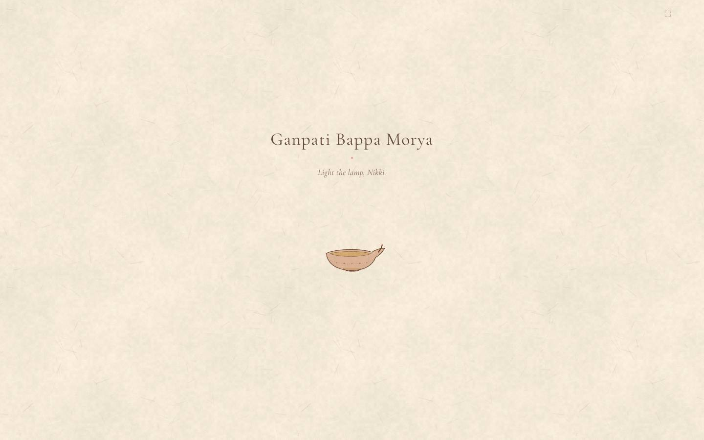
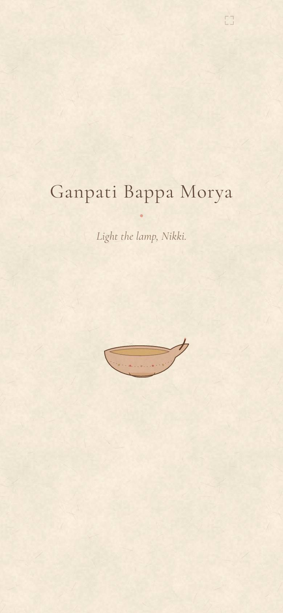

# Morya

> An interactive painting: draw across it with a finger or pointer and the artwork responds. The app lives in [`morya/`](morya/).

**Live:** [praashi-morya.vercel.app](https://praashi-morya.vercel.app)

<p align="center">
  
  
</p>

## Built with

React · TypeScript · Vite · Canvas

## Run locally

```bash
cd morya
npm install
npm run dev
```

## License

Code is released under the [MIT License](LICENSE). Photos, video, artwork, audio and written content are not covered by it: personal media is © Prawal Sharma, all rights reserved, and third-party assets remain under their own licenses.
